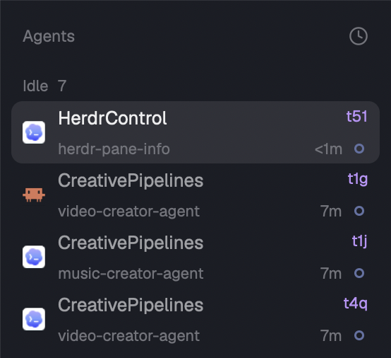

<div align="center">

# Terminal IDs for Herdr

**See and copy terminal IDs in your panes and agent list.**

[](https://herdr.dev/mods)
[](LICENSE)



</div>

One mod, two places to find the terminal you need:

- **Agent list:** workspace and clickable terminal ID on the first line; tab title, age and status below. Sub-agents show their IDs too.
- **Pane header:** clickable terminal ID beside the program and folder, with the usual split, zoom and close controls.

Click an ID to copy it and see **Address copied**. An ID such as `t51` identifies a terminal, not a tab or pane. Remote addresses retain their machine prefix (`vps/t51`), including when copied. Long addresses may be truncated on screen but are copied in full.

## Install

Built against Herdr 0.1.13. Ask your agent:

```text
Read ~/.config/herdr-app/AGENTS.md, then install
https://github.com/dendenlarin/herdr-terminal-ids using its RECIPE.md.
Preserve my existing layout and panels.
```

Or copy `mods/terminal-ids/` into your app home's `mods/` directory (default `~/.config/herdr-app`, or `$HERDR_APP_HOME`). Back up any existing copy; write `mod.json` before `main.js` to prevent automatic docking.

Edit a personal layout. If yours is shipped, clone it first (this switches to the copy):

```sh
herdr-app do layout.clone '{"name":"main","as":"main-terminal-ids"}'
```

For the sidebar, set the agents block's content to:

```json
{ "mod": "terminal-ids", "props": { "role": "agents" } }
```

For the pane header, find the block with `content.tab: "active"` and set `content.pane.header` to:

```json
{
  "content": { "mod": "terminal-ids", "props": { "role": "pane" } },
  "reveal": "always",
  "height": 30,
  "position": "top"
}
```

Set `content.pane.lone` to `true` to show the header with only one pane. Preserve unrelated fields and panels. Either placement can be used independently; both use the same installed mod.

```sh
herdr-app check ~/.config/herdr-app/mods/terminal-ids
herdr-app status
```

No hooks, build step, network requests or background process. Uses Herdr's built-in icons and live data. Sorting, pins, focus, sub-agent folding and the narrow sidebar rail retain the standard behavior. Clicking an ID does not select another agent.

## Upgrade from Pane Info

Install `terminal-ids` first. Replace `agents-address` references with `terminal-ids` and add `props.role: "agents"`. Replace `pane-address` references with `terminal-ids` and add `props.role: "pane"`. Preserve other props and layout fields. After checking the new layout, remove old mod folders only if no layouts reference them. Sidebar state-age tracking starts fresh after migration.

## Remove

Restore the sidebar block to `agents` and the pane header to its previous configuration (usually `pane`), including its previous `lone` setting. Remove `mods/terminal-ids/` once no layouts reference it.

## Development

`main.js` selects the view from `props.role`; `agents.js` and `pane.js` implement the two views. The sort popup uses the agents role too. Run `herdr-app check mods/terminal-ids`, then inspect both placements in a personal layout, including the sort menu and ID copying. The check renders only the initial state; it does not simulate clicks. Check live errors with `herdr-app status` and inspect a `herdr-app shot` screenshot.

The views derive from Herdr 0.1.13's shipped mods and need manual review when those upstream mods change.

## License and credits

Licensed under [Apache-2.0](LICENSE), including the modifications to Herdr's `agents` and `pane` mods; see [NOTICE](NOTICE). Icon terms are included in [THIRD-PARTY-NOTICES](THIRD-PARTY-NOTICES).
