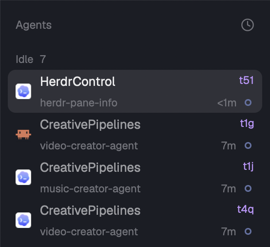

# Terminal IDs for Herdr

One mod installed at `mods/terminal-ids`, rendered in two layout slots via props.role.

## Structure and behavior

- main.js owns one view per slot, initializes it and delegates render. Role agents selects agents.js; the pane role (default) selects pane.js.
- agents.js: 44px agent rows, icon at left, workspace name and accent-colored 11px terminal address on top; tab title, age/status and hover controls below. Sub-agent rows are 40px with name and address. Preserve sorting, pins, navigation, folding and the compact rail. The sort popup opens terminal-ids with role agents and sortMenu true.
- pane.js: resolve props().pane in panes(); preserve program, folder, status and pane controls. Omit the address when no terminal exists.
- Copy the full address with native clipboard writing, stop click propagation and notify Address copied for 1600ms. Preserve remote machine prefixes. Use theme colors and native spinner animation.
- Local SVG control assets live beside main.js. Shared workspace-chrome icons are supplied by Herdr.

## Installation and migration

Read the installed Herdr AGENTS.md and API declarations. Respect HERDR_APP_HOME. Back up existing files. Install mod.json before main.js. Clone shipped layouts before editing. Follow the exact layout snippets in README.md, preserving all unrelated fields and panels. Both placements are optional and use one mod folder.

For older installs, migrate agents-address to terminal-ids with role agents and pane-address to terminal-ids with role pane. Remove the old folders only after all layout references are migrated. Local age tracking starts fresh; do not alter unrelated shared state.

## Verification

Run herdr-app check on the packaged and installed folder. Check herdr-app status and inspect screenshots of both placements. Exercise the sorting popup, address copy, focus and sub-agent controls. Verify full remote addresses are copied and no row-selection action propagates from address clicks. The initial-render check alone does not cover those interactions.

## Removal

Restore the agents block and pane header/lone configuration before removing the mod folder. See README.md.
